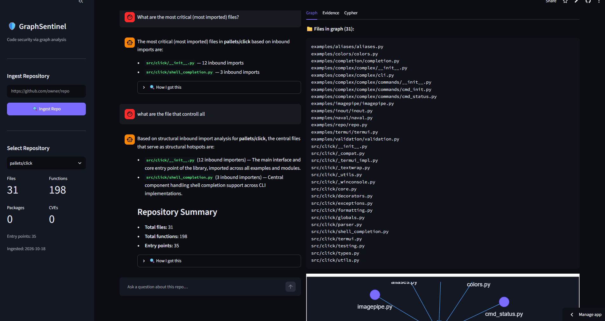
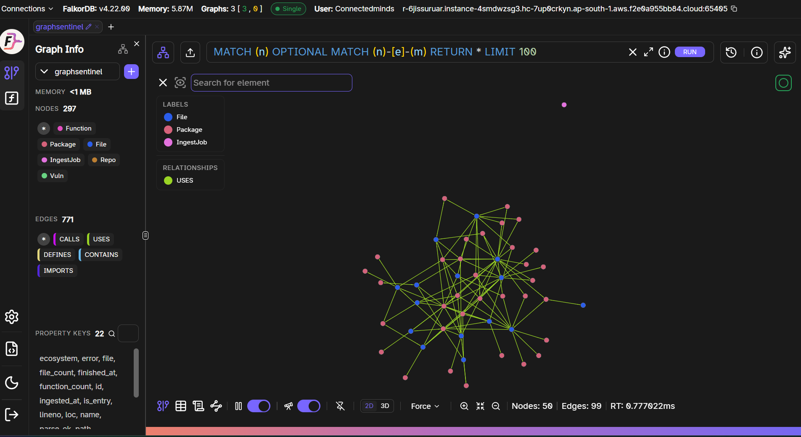
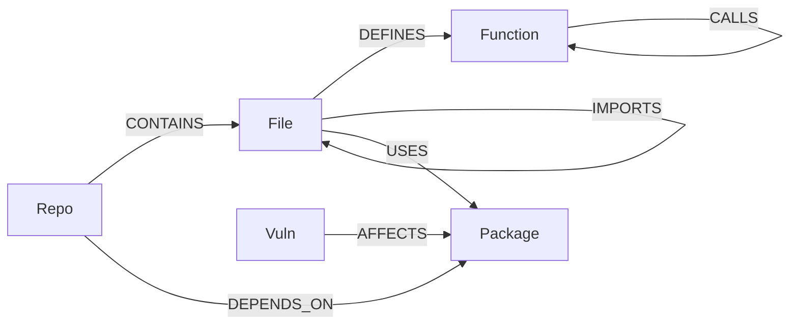
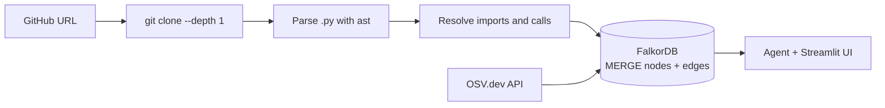

<div align="center">

# 🛡️ GraphSentinel

### Ask your codebase *"Which CVEs are actually reachable?"*
**An AI security agent that answers by walking a FalkorDB code graph, and shows the path as proof.**


**🏆 GraphHacks 2026** · Track 1: *Agents That Act on Connected Data* · Bonus: Track 2 *Agent Memory*

[🚀 Live Demo](#-live-demo) · [🎬 Demo Video](#-live-demo) · [🧬 Graph Model](#-graph-data-model) · [🔎 Cypher Queries](queries.cypher) · [⚡ Quick Start](#-quick-start)

</div>

---

## ✨ What it does

Paste a public Python GitHub repo URL. GraphSentinel:

1. **Ingests** it, parsing every file, function, import and call with `ast`
2. **Builds a property graph** in FalkorDB: files, functions, packages, and known vulnerabilities (OSV.dev)
3. **Answers plain-English security questions** by chaining graph queries as agent tools, answering *only* from what the graph returns
4. **Shows its work**: the graph view, the evidence, and the exact Cypher behind every answer

> 💬 *"Which files are most imported?"* · *"What breaks if I change `core.py`?"* · *"Are there circular imports?"* · *"Which vulnerabilities are reachable?"* · *"How does `cli.py` connect to `core.py`?"*

## 🎯 Why the graph matters

A flat CVE scanner tells you **what** is vulnerable. GraphSentinel tells you **whether it's reachable from your code**, **what breaks if you change a file**, and **which package upgrade removes the most exposure**.

**Remove FalkorDB and the product stops working. The graph *is* the product.**

---

## 🖼️ Screenshots

| Chat + Evidence | Graph View |
|---|---|
|  |  |

---

## 🧬 Graph data model



<details>
<summary><b>📋 Node labels</b></summary>

| Label | Key properties |
|---|---|
| `Repo` | `repo` (owner/name), `url`, `ingested_at`, `file_count`, `function_count` |
| `File` | `repo`, `path`, `loc`, `parse_ok` |
| `Function` | `repo`, `qualname`, `file`, `lineno`, `is_entry` |
| `Package` | `repo`, `name`, `version`, `ecosystem` |
| `Vuln` | `id` (CVE/GHSA), `summary`, `severity`, `aliases`, `fixed_in` |
| `IngestJob` | `id`, `repo`, `status`, `step`, `error`, `started_at`, `finished_at` |

</details>

<details>
<summary><b>🔗 Edge types</b></summary>

| Edge | From → To | Meaning |
|---|---|---|
| `CONTAINS` | Repo → File | repo owns file |
| `DEFINES` | File → Function | function defined in file |
| `IMPORTS` | File → File | internal import |
| `USES` | File → Package | file imports external package |
| `CALLS` | Function → Function | call edge (best-effort, `resolved` flag) |
| `DEPENDS_ON` | Repo → Package | listed in manifest |
| `AFFECTS` | Vuln → Package | vulnerable version range |

</details>

📄 Every Cypher query the product depends on is in [`queries.cypher`](queries.cypher).

---

## 🤖 Agent tools

The LLM never touches the database directly. It calls **8 read-only graph tools** (`tools.py`), each backed by a parameterised Cypher query:

| Tool | Question it answers |
|---|---|
| `get_repo_summary` | How big is this repo? (files, functions, packages, CVEs) |
| `most_imported` | Which files are most depended on? |
| `find_dependents` | What breaks if I change this file? (blast radius) |
| `find_dependencies` | What does this file rely on? |
| `find_cycles` | Are there circular imports? |
| `list_vulns` | Which vulnerabilities affect this repo? |
| `reachable_vulns` | Which vulns are reachable via call/import paths? |
| `explain_path` | How does file A connect to file B? |

---

## ⚡ Quick start

<details open>
<summary><b>Option A: Docker Compose</b></summary>

```bash
cp .env.example .env        # fill in GEMINI_API_KEY and FalkorDB credentials
docker compose up --build
```
- Streamlit UI: http://localhost:8501
- FalkorDB Browser: http://localhost:3000

</details>

<details>
<summary><b>Option B: Local (no Docker)</b></summary>

```bash
cp .env.example .env        # fill in credentials
pip install -r requirements.txt
python cli.py health        # confirm DB connection
python cli.py ingest https://github.com/pallets/click
python -m streamlit run app.py
```

</details>

<details>
<summary><b>Option C: Streamlit Cloud</b></summary>

1. Fork this repo
2. Deploy at [share.streamlit.io](https://share.streamlit.io) and point it to `app.py`
3. In **Settings → Secrets** add:

```toml
FALKORDB_HOST = "your-cloud-host"
FALKORDB_PORT = "your-port"
FALKORDB_USERNAME = "your-username"
FALKORDB_PASSWORD = "your-password"
FALKORDB_SSL = "false"
FALKORDB_GRAPH = "graphsentinel"
GEMINI_API_KEY = "your-gemini-key"
GEMINI_MODEL = "gemini-flash-latest"
```

</details>

### 🖥️ CLI

```bash
python cli.py health                                         # check DB connection
python cli.py ingest https://github.com/pallets/click        # ingest a repo
python cli.py summary pallets/click                          # file / function / CVE counts
python cli.py top --repo pallets/click                       # most-imported files
python cli.py blast src/click/core.py --repo pallets/click   # blast radius
python cli.py cycles --repo pallets/click                    # circular imports
python cli.py repos                                          # list ingested repos
```

---

## 🔄 Ingest pipeline



1. Validate the URL and clone shallowly, enforcing size and time limits
2. Parse defs, imports and calls with `ast`
3. Write `Repo`, `File`, `Function`, `Package` nodes and `CONTAINS` / `DEFINES` / `IMPORTS` / `USES` edges (idempotent `MERGE`)
4. Resolve intra-repo calls into `CALLS` edges (best-effort)
5. Read `requirements.txt` / `package.json` into `DEPENDS_ON` edges
6. Query [OSV](https://google.github.io/osv.dev/api/) in batches and write `Vuln` nodes plus `AFFECTS` edges

---

## 🧰 Tech stack

| Concern | Choice |
|---|---|
| Graph database | **FalkorDB** (primary and only datastore) |
| UI | Streamlit + pyvis |
| LLM | Google Gemini via the `gemini_client.py` adapter |
| Vulnerability data | OSV.dev API |
| Parsing | Python stdlib `ast` |
| HTTP | `httpx` with retries |

---

## 🚀 Live demo

| | |
|---|---|
| 🌐 **Live app** | `https://connected-minds-fjque54tdzeba78jysc54d.streamlit.app/` |
| 🎬 **Demo video** | [Watch on OneDrive](https://1drv.ms/v/c/1aa180e5e002f2c6/IQD5-4TRl99cSJhhrocyxs2wAXgQF8vQwOYM3WWgTnw6Ovw?e=KuKkEZ) |
| 📦 **Repository** | https://github.com/saileshkoirala011/Connected-Minds |

---

## ⚠️ Known limitations

- Python call resolution is approximate (dynamic dispatch, decorators and reflection are not supported)
- Reachability via `CALLS` edges is **best-effort**, not proof of exploitability
- CVE enrichment needs versioned dependencies; libraries without version pins show 0 CVEs

---

## 🤝 AI-use disclosure

This project was built with AI coding assistance (Kiro IDE, powered by Claude/Anthropic). All Cypher queries, the graph schema and architectural decisions were designed by the team. AI assisted with implementation, debugging and code generation. The runtime agent uses Google Gemini through `gemini_client.py`. All generated code was reviewed and tested before use.

---

## 📚 Docs

[Architecture](docs/architecture.md) · [Backend schema](docs/backend-schema.md) · [PRD](docs/prd.md) · [Cypher queries](queries.cypher) · [FalkorDB docs](https://docs.falkordb.com) · [OSV API](https://google.github.io/osv.dev/api/)

<div align="center">

**Built for GraphHacks 2026 · Powered by FalkorDB** 🛡️

</div>